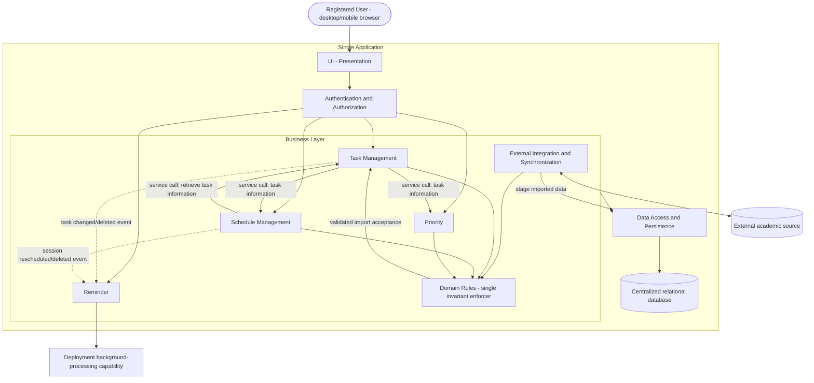

# Architecture — Study Management System

**Group #7 · Requirements source:** Updated PRD v1.2 (derived from the supplied PRD v1.1 and subsequent group decisions)  
**Decision sources:** ADR-001 to ADR-006 (Proposed; subject to project-team approval)

---

## 1. System Overview

The Study Management System gives Ms. Arooj one web application for organizing academic tasks and deadlines, understanding task priority, and following a Flexible Study Schedule. It supports importing tasks from an external academic source, checking imported information for updates, tracking task completion, configuring in-app reminders, and recording study time.

The application is accessed through desktop and mobile browsers and is initially deployed as one application. It organizes information and supports planning only. It does not take responsibility for academic performance, make academic decisions, act as the official source of deadlines, or assess academic work (BR-03 to BR-05; PC-01 to PC-04).

The architecture is a **Layered Modular Monolith**. Modules have defined responsibilities and communicate through internal service interfaces and events. The application uses a centralized relational database. Operations within one domain use database transactions. Cross-module dependent updates use event-driven communication and eventual consistency, with retries and recovery.

## 2. Architectural Goals and Drivers

| # | Driver | Derived from | Architectural concern |
|---|---|---|---|
| 1 | External Integration | FR-01, FR-08 | External communication, importing, update checking, staging, and integration failures |
| 2 | Data Consistency and Integrity | BR-02, FR-03, FR-08, NFR-04 | Validated changes, transactional domain operations, conflicting updates, and eventual cross-module consistency |
| 3 | Security and Privacy | NFR-03 | Authentication, authorization, and isolation of user-specific records |
| 4 | Reliability and Recovery | NFR-04, FR-14 | Event retries, failure logging, backups, restoration, and reconciliation |
| 5 | Cross-Platform Compatibility | NFR-02, PC-06 | Desktop and mobile browser support |
| 6 | Performance | NFR-05 | Response-time expectations and verification once targets are established |
| 7 | Availability | NFR-06, PC-07 | Access expectations, including evenings and weekends |
| 8 | Reminder Processing | FR-14 | User-configured reminder preferences, background scheduling, and in-app notification delivery |

Maintainability and separation of responsibilities are design goals supporting ADR-001.

## 3. Architecturally Significant Requirements

| Source requirement | Why architecturally significant | Architectural concern |
|---|---|---|
| FR-01, FR-08 | External-source interaction includes incomplete and failed operations | Integration boundary, staging, validation, update checking, and failure handling |
| BR-02, FR-03, FR-08, NFR-04 | Task and deadline information must remain accurate | Domain validation, database integrity, synchronization, and recovery |
| NFR-03 | Protected records must be available only to authenticated and authorized users | Authentication, authorization, and user-data isolation |
| NFR-04 | Synchronization, backup, and recovery are required | Transaction boundaries, event retries, logging, backup, restoration, and reconciliation |
| NFR-02, PC-06 | Desktop and mobile browsers are supported environments | Responsive UI and browser compatibility |
| NFR-05 | Performance targets must be established | Response-time measurement and verification |
| NFR-06, PC-07 | Access is expected at any time, including evenings and weekends | Availability and continuity |
| FR-14 | Reminders must be configurable and delivered at user-selected times; the mechanism requires background processing | Reminder preferences, background scheduling, in-app delivery, and deployment-dependent processing |

FR-07 and FR-09 remain relevant scheduling considerations. Automatic rescheduling behavior remains subject to the PRD's open questions.

## 4. Architectural Style and Rationale

The system uses a **Layered Modular Monolithic Architecture** (ADR-001): presentation, business, and data-access responsibilities are separated, and business functionality is divided into modules within one initially deployed application.

Traditional Monolithic Architecture was rejected because it offers less explicit modular separation, potentially making the system harder to maintain, test, and extend as its features grow. Microservices were rejected because they introduce inter-service communication, distributed transaction, deployment, and recovery complexity that is not justified by the current project scale. A separate External Integration module is included to isolate import and synchronization responsibilities without requiring a separately deployed service.

The selected style balances modularity, maintainability, reliability, and development simplicity. Trade-offs include a shared application failure domain and no independent deployment or scaling of modules.

## 5. Major Components

| # | Component | Layer | Responsibility | Must not |
|---|---|---|---|---|
| 1 | UI | Presentation | Dashboard, task list, filters, completion display, timer controls, reminder preferences, schedule view, responsive browser UI | Contain business rules or access the database/external source directly |
| 2 | Authentication and Authorization | Business entry boundary | Authenticate registered users, assign the Registered User role on registration, authorize protected operations, and enforce user-specific data access | Be bypassed by protected operations |
| 3 | Task Management | Business | Own tasks, deadlines, completion status/date, explicit task deletion, Recorded Study Sessions, timer operations, and per-task recorded-time totals | Compute Task Priority or own Scheduled Study Sessions |
| 4 | Priority | Business | Own and calculate Task Priority according to approved deadline-based rules | Use study-time data to change priority or deadlines; invent tie-breaking rules |
| 5 | Schedule Management | Business | Own availability, Study Schedule, and Scheduled Study Sessions; create, display, adjust, and delete scheduled sessions according to approved rules | Automatically move sessions before the relevant scheduling decisions are approved |
| 6 | Reminder | Business | Own reminder preferences and pending reminders; manage user enable/disable preferences and configured notification times; schedule and deliver in-app notifications; react to reschedule/delete events | Own task or session records |
| 7 | External Integration and Synchronization | Business / Integration | Communicate with external academic sources; import and check updates; own staged imported data and sync logs; report failed/incomplete operations accurately | Apply business rules or write directly to database tables |
| 8 | Domain Rules | Business shared component | Act as the single enforcer of domain invariants; validate state-changing operations; identify deadline conflicts for review; validate staged imports; ensure failed/incomplete imports are not reported as successful | Depend on UI, database, or external-source implementation details |
| 9 | Data Access and Persistence | Data | Provide controlled persistence interfaces over the centralized relational database; support domain transactions, operation/event records, backup, and restoration | Contain business logic or permit modules to bypass ownership boundaries |

### Study-session distinction

- **Recorded Study Sessions** are historical records of study activity completed or recorded by the user. Task Management owns them.
- **Scheduled Study Sessions** are planned future activities placed in the Study Schedule. Schedule Management owns them.

Each module manages its own records and exposes required information through defined interfaces.

## 6. Boundaries and Dependency Rules

1. The application follows presentation, business, and data-access boundaries. UI requests pass through the Authentication and Authorization boundary before protected operations are executed.
2. Domain Rules is the **single enforcer** of domain invariants. Every state-changing operation must be validated by Domain Rules before the corresponding persistence change is committed.
3. A state-changing operation creates, updates, or deletes stored data. Read-only queries may use controlled Data Access interfaces without Domain Rules validation, but remain subject to authentication, authorization, and data-ownership rules.
4. Only External Integration communicates with external academic sources.
5. Only Data Access communicates directly with the database. Modules must not read or modify another module's tables directly.
6. Each module owns its assigned data. Other modules use the owner's service interface to retrieve information or request operations.
7. Modules communicate through defined internal service interfaces and events. Service calls are used when an immediate response, information retrieval, or an operation request is required. Events notify interested modules after an operation has successfully completed.
8. Authentication and authorization checks apply to protected service operations and user-specific record retrieval, not merely to UI navigation.
9. Task Management owns Recorded Study Sessions. Schedule Management owns Scheduled Study Sessions and user availability.
10. Priority data flows from Task Management to Priority. Recorded study time is not an input to Task Priority or academic deadlines.
11. Domain Rules identifies deadline conflicts and flags them for user review. It does not decide the official deadline or act as the authority for academic information.
12. Imported task information follows this lifecycle: External Integration stages it; Domain Rules validates it; Task Management accepts and owns it as an application task.

## 7. Interfaces and Interactions

| From → To | Purpose |
|---|---|
| UI → Authentication and Authorization → business services | Authenticate and authorize user actions |
| Task Management → Domain Rules | Validate task, deadline, completion, deletion, and recorded-session changes |
| Schedule Management → Domain Rules | Validate availability and scheduled-session changes |
| Priority → Domain Rules | Validate changes to owned priority data where applicable |
| Task Management → Priority | Provide task/deadline changes for priority calculation |
| Priority → Schedule Management | Provide priorities required for scheduling |
| Schedule Management → Task Management (service call) | Retrieve task information required for scheduling |
| Task Management → Reminder (event) | Notify Reminder after a task is successfully rescheduled or deleted |
| Schedule Management → Reminder (event) | Notify Reminder after a scheduled session is successfully rescheduled or deleted |
| Reminder → in-app notification facility | Deliver notifications at configured times |
| External Integration → staged-import storage | Persist imported source data before acceptance |
| External Integration → Domain Rules | Request validation of staged import data and synchronization outcomes |
| Domain Rules → Task Management | Permit validated staged tasks to be accepted by the task owner |
| Modules → Data Access | Persist or retrieve data through controlled interfaces, respecting ownership and transaction boundaries |
| External Integration ↔ external academic source | Import tasks and check updates |

### Communication semantics

- **Service calls** are synchronous module requests where the caller needs a response, needs information, or asks the owning module to perform an operation.
- **Events** communicate that an operation has successfully completed and allow other modules to react independently.
- Event-driven dependent updates are eventually consistent. They may not be reflected immediately in every dependent module.
- Event processing uses the retry, failure logging, duplicate prevention, and recovery policy described in ADR-005 and ADR-002.
- For example, after a task is deleted, its associated reminder may remain temporarily until the deletion event is processed successfully. Retry and recovery mechanisms support eventual consistency.

### Reminder behavior

The system delivers reminders through **in-app notifications**. Users control reminder preferences, including enabling or disabling reminders and configuring notification times. The Reminder Module manages configurations and uses a background scheduling mechanism to trigger notifications at configured times. Delivery while the application is closed depends on background-processing capabilities available in the deployment environment; this is not guaranteed independently of that environment.

## 8. Data Responsibilities

The system uses a centralized relational database, logically organized by module ownership.

| Data | Owner |
|---|---|
| Tasks, deadlines, completion status/date | Task Management |
| Recorded Study Sessions and total recorded study time | Task Management |
| Task Priority | Priority |
| User availability, Study Schedule, Scheduled Study Sessions | Schedule Management |
| Reminder preferences, configurations, and pending reminders | Reminder |
| Users, authentication information, and role assignments | Authentication and Authorization |
| Staged imported task information and sync log | External Integration and Synchronization |
| Deadline-conflict identification and validation rules | Domain Rules (no persistent task ownership) |

Domain Rules validates staged imports. After successful validation, Task Management accepts the imported task and becomes its owner. Staged source data remains owned by External Integration until acceptance or disposition.

Only the owning module changes its records, through Data Access interfaces. The database product remains to be selected.

## 9. External Systems

| System | Boundary |
|---|---|
| External academic source (e.g., LMS; not yet selected) | Accessed only through External Integration. Feasibility, authentication, duplicate handling, cancellation handling, and source-specific synchronization details remain subject to PRD open questions. |
| Deployment background-processing capability | Used by Reminder to trigger configured in-app notifications. Behavior when the application is closed depends on the capabilities of the chosen deployment environment. |
| External authentication provider | Not selected or required by this architecture decision; any use remains subject to the authentication investigation. |

No other external service is assumed.

## 10. Architectural Constraints

- Follow PRD business rules and product constraints.
- Support desktop and mobile browsers.
- Initially deploy as one application.
- Use centralized relational persistence with controlled Data Access.
- Enforce authentication, authorization, and user-specific record isolation.
- Only External Integration communicates with the external academic source.
- Domain Rules is the single enforcer of domain invariants.
- Do not invent performance, availability, scheduling, or prioritization rules.
- Reminder delivery is in-app; delivery while the application is closed depends on deployment background-processing capability.
- Domain operations use database transactions. Cross-module dependent updates use events and eventual consistency rather than distributed transactions.
- Keep implementation-specific retry intervals, maximum attempts, database product, and deployment technology open for implementation decisions.

## 11. Architecture Diagram

## 12. Quality Attribute Handling

| Attribute | Architectural support | Responsible components |
|---|---|---|
| Consistency and integrity | Domain validation; database transactions within a domain; event-driven eventual consistency across modules | Domain Rules, module owners, Data Access |
| Reliability and recovery | Event retry policy, unique event identifiers, failure logs, operation logs, scheduled database backups, restoration and reconciliation | Event processor, Data Access, External Integration |
| Security and privacy | Central authentication and authorization; one Registered User role; user-specific record isolation | Authentication and Authorization; all protected service interfaces |
| Maintainability | Layer separation, module ownership, defined service interfaces and event contracts | All modules |
| Availability and performance | Single deployment; measurement and verification targets remain to be established | Application-wide |
| Compatibility | Responsive desktop/mobile browser UI | UI |
| Reminder delivery | In-app notifications triggered by background scheduling; closed-app behavior depends on deployment capabilities | Reminder |

## 13. Known Risks and Open Decisions

- External academic source, feasibility, and authentication method remain open.
- Import duplicate handling, source cancellation, partial synchronization, and source authentication failure behavior remain open.
- Deadline-conflict conditions and disputed-deadline treatment remain open, although Domain Rules owns conflict identification and flags conflicts for review.
- Scheduling rules, missed-session behavior, and automatic versus user-approved rescheduling remain open.
- Reminder times already passed, delivery failure handling, and reminders for completed tasks remain open.
- Background notification delivery while the application is closed depends on deployment capabilities.
- Cross-module event updates are eventually consistent; dependent data may temporarily lag behind the initiating operation.
- Retry intervals and maximum attempts are configured during implementation. Persistent failures require investigation and possible manual recovery.
- Database product, authentication implementation, and deployment technology remain open.
- Availability and performance targets remain to be established.

## 14. Related ADRs

| ADR | Topic | Status |
|---|---|---|
| ADR-001-architecture-style.md | Layered Modular Monolithic Architecture | Proposed |
| ADR-002-data-persistence.md | Centralized relational database, transactions, backup and recovery | Proposed |
| ADR-003-authentication-boundary.md | Centralized Authentication and Authorization; Registered User role | Proposed |
| ADR-004-external-integration.md | External Integration, staging, validation, and task acceptance | Proposed |
| ADR-005-module-communication.md | Service interfaces, events, retries, and eventual consistency | Proposed |
| ADR-006-module-responsibilities.md | Module ownership, Domain Rules, and Reminder boundary | Proposed |
